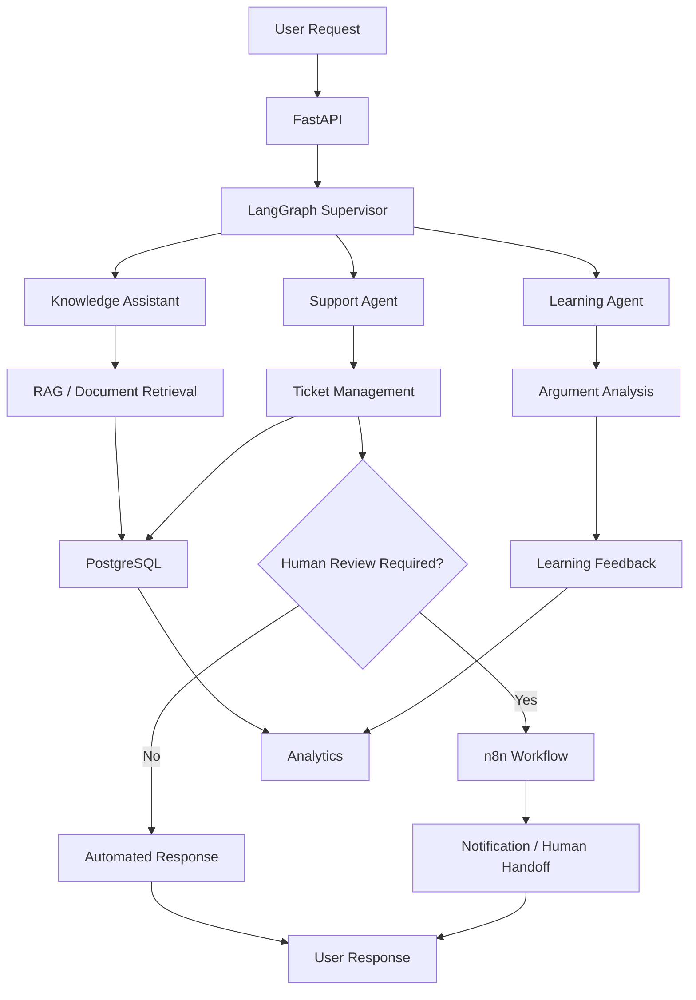

# CritiqAI Nexus
**Multi-Agent AI Platform for Knowledge, Learning & Business Workflow Automation**

An extensible MVP for educational organizations and knowledge-driven teams. It combines a support workflow, tenant-scoped knowledge retrieval, argumentation feedback, analytics, and an optional n8n escalation webhook.

## Included and runnable
- FastAPI REST API: support, knowledge, learning, analytics, health.
- LangGraph support workflow with deterministic mock provider (no API key needed).
- Document ingestion API and TF-IDF lexical retrieval with source metadata.
- Tenant identifiers on stored records and tenant-filtered retrieval.
- SQLite default for quick local run; PostgreSQL in Docker Compose.
- Optional Qdrant, Redis and n8n services in Compose.
- Pytest smoke tests and GitHub Actions CI.

## Quick start
Requires Python 3.11+.
```bash
python -m venv .venv
source .venv/bin/activate  # Windows: .venv\Scripts\activate
pip install -r requirements.txt
cp .env.example .env
uvicorn app.main:app --reload
```
Docs: http://127.0.0.1:8000/docs

## Try it
```bash
curl -X POST http://127.0.0.1:8000/api/v1/support/chat -H "Content-Type: application/json" -H "X-Tenant-ID: demo-university" -d '{"user_id":"student-1","message":"I cannot access my course account"}'
curl -X POST http://127.0.0.1:8000/api/v1/knowledge/ingest -H "Content-Type: application/json" -H "X-Tenant-ID: demo-university" -d '{"title":"Course access","text":"Students access materials through the Learning Portal. Reset your password if sign-in fails, then contact the help desk if the issue continues.","source":"policy.md"}'
curl -X POST http://127.0.0.1:8000/api/v1/knowledge/ask -H "Content-Type: application/json" -H "X-Tenant-ID: demo-university" -d '{"question":"How do I access course materials?"}'
```

## Docker
`docker compose up --build` starts API, PostgreSQL, Qdrant, Redis, and n8n. The sample database password is for local development only.

## Current limitations — do not describe this as production-ready
- Mock provider is deterministic; it is not real LLM reasoning.
- Retrieval currently uses TF-IDF, not dense embeddings, hybrid search, or reranking.
- Qdrant and Redis are provisioned but not yet wired into runtime logic.
- Tenant filtering is implemented in application queries, but the `X-Tenant-ID` header is not authentication. Add identity, authorization, and PostgreSQL RLS before deployment.
- n8n workflow is a starter webhook and needs credentials and downstream notification nodes.
- Upload UI, JWT/RBAC, real LLM adapter, background workers, monitoring, and frontend are future work.

## Roadmap
1. JWT authentication, organization membership, roles, and RLS.
2. Embeddings + Qdrant tenant payload filters; hybrid retrieval and reranking.
3. Retrieval evaluation: Recall@K, MRR, citation precision.
4. Real Gemini/OpenAI adapter with structured output and retries.
5. Redis-backed background jobs and human review queue.
6. Frontend dashboard, observability, deployment hardening.

## Structure
`app/agents` LangGraph; `app/api` FastAPI; `app/database` SQLAlchemy; `app/rag` retrieval; `app/learning` argument feedback; `n8n` workflow export; `tests` automated tests; `docs` architecture notes.


## معرفی پروژه
پروژه **CritiqAI Nexus** یک پلتفرم هوشمند مبتنی بر عامل‌های هوش مصنوعی (Multi-Agent AI) است که با هدف خودکارسازی فرآیندهای پشتیبانی، مدیریت دانش و آموزش طراحی شده است. این سامانه با استفاده از پردازش درخواست‌های کاربران، جست‌وجو در اسناد سازمانی (RAG)، تحلیل و ارزیابی استدلال و گردش‌کارهای هوشمند، می‌تواند به سؤالات پاسخ دهد، اطلاعات مرتبط را بازیابی کند و درخواست‌های نیازمند بررسی را به نیروی انسانی ارجاع دهد.

این پروژه با استفاده از **Python، FastAPI، LangGraph، PostgreSQL و n8n** توسعه داده می‌شود و بستری قابل توسعه برای ساخت دستیارهای هوشمند سازمانی و اتوماسیون فرآیندهای کسب‌وکار فراهم می‌کند. همچنین با حفظ قابلیت‌های تحلیل استدلال و یادگیری، ادامه‌ای کاربردی بر ایده پژوهشی CritiqAI محسوب می‌شود.

## نمای کلی معماری و گردش‌کار


